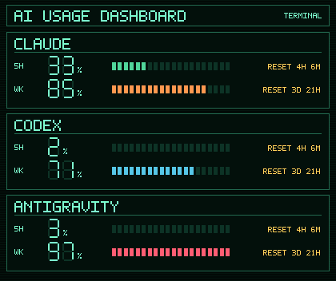

# AIUsageBar for Windows

A small Windows tray app that shows how much of your **Claude**, **Codex** and **Antigravity** quota you have used — 5-hour and weekly — without opening any of them.



- Zero dependencies: PowerShell 5.1+ (built into Windows 10/11), nothing to install.
- Right-click the tray icon for the panel; the icon and tooltip show your highest usage.
- Click a 5H or WK row to make the icon follow only that quota. Click again to go back to the highest.
- Green below 50%, cyan below 75%, yellow below 85%, orange below 95%, red from 95%.
- Refreshes every 60 seconds. If a request fails it keeps the last reading (marked `OLD`) and backs off.

> ## Read this first
>
> **This is an unofficial tool.** Claude, Codex and Antigravity have no public API for subscription usage, so AIUsageBar calls the same **undocumented endpoints** that those tools' own CLIs use, and it identifies itself the way those CLIs do. That means:
>
> - It can **stop working at any time** when a provider changes something.
> - It may not be permitted by a provider's terms of service. **You are responsible for checking that it is acceptable for your accounts.** The authors are not affiliated with Anthropic, OpenAI or Google.
> - It reads the login files your CLIs already created (see [Credentials](#credentials)). Only run software you trust with them — read `AIUsageBar.ps1` first; it is a single readable script.

## Install

**Run from source (recommended — nothing to trust but the script):**

```powershell
git clone https://github.com/Jang1117/AIUsageBar.git
cd AIUsageBar
powershell -ExecutionPolicy Bypass -File AIUsageBar.ps1
```

Running the `.ps1` briefly opens a console window. To avoid that, build the exe yourself:

```powershell
powershell -ExecutionPolicy Bypass -File .\Build.ps1   # installs ps2exe for your user if needed, writes dist\AIUsageBar.exe and dist\SHA256SUMS.txt
```

**Prebuilt exe:** download `AIUsageBar.exe` from the [Releases page](https://github.com/Jang1117/AIUsageBar/releases) and compare its SHA-256 with `SHA256SUMS.txt` from the same release. The exe is **not code-signed**, so Windows SmartScreen or your antivirus may warn about it (this is common for exes made with ps2exe).

On first run it asks whether to start with Windows. You can change that later:

```powershell
.\AIUsageBar.exe -Install      # start on login
.\AIUsageBar.exe -Uninstall    # stop starting on login
```

## Credentials

AIUsageBar does not ask you to sign in. It reads what your CLIs already store, and sends tokens only to the provider they belong to:

| Provider | Read from | Sent to |
|---|---|---|
| Claude | `~/.claude/.credentials.json` (or env `AIUSAGEBAR_CLAUDE_OAUTH_TOKEN`) | `api.anthropic.com`, `platform.claude.com` |
| Codex | `~/.codex/auth.json` | `chatgpt.com` |
| Antigravity | Windows Credential Manager (`gemini:antigravity`), or the legacy `~/.gemini/antigravity-cli/antigravity-oauth-token` | `daily-cloudcode-pa.googleapis.com`, `oauth2.googleapis.com` |

No telemetry, no analytics, nothing else leaves your machine. Logs go to `~/.aiusagebar/aiusagebar.log` and contain usage percentages, not tokens.

### Claude: read-only by default

Your Claude login file is **never written by default**. If the access token has expired, the panel shows **"Claude: Login expired"** until Claude Code renews it (just use Claude Code once); the next poll picks up the new token automatically.

Claude's refresh tokens rotate when used. If AIUsageBar refreshed the token at the same moment Claude Code did, one of them would be left with an invalid token and you could get signed out of Claude Code. You can opt in anyway:

```powershell
.\AIUsageBar.exe -AllowClaudeTokenRefresh
# or set the environment variable AIUSAGEBAR_CLAUDE_REFRESH=1
```

When enabled, it re-checks the file right before refreshing, changes only `accessToken`, `refreshToken` and `expiresAt` in the file's text, and swaps the file in one step. It still cannot make the race impossible.

### Antigravity: token renewal is optional

The Antigravity token is renewed through Google's OAuth endpoint, which needs a client secret that is **not included in this repository** (GitHub blocks it as a secret). Without it, AIUsageBar uses the token the CLI saved for as long as it is valid; when it expires, start `agy` once to renew it. To let AIUsageBar renew it, provide the Antigravity CLI's installed-app client secret yourself, either as an environment variable or in `~/.aiusagebar/config.json`:

```json
{ "antigravityOAuthClientSecret": "..." }
```

Refreshed tokens stay in memory; your CLI login is never modified.

## Options

| Parameter | Default | Description |
|---|---|---|
| `-PollIntervalSeconds` | 60 | How often to refresh |
| `-AllowClaudeTokenRefresh` | off | Let the app refresh (and rewrite) the Claude login. See above |
| `-Debug` | off | Print log output to the console |
| `-Install` / `-Uninstall` | — | Add or remove the Windows startup entry, then exit |

| Environment variable | Purpose |
|---|---|
| `AIUSAGEBAR_CLAUDE_REFRESH=1` | Same as `-AllowClaudeTokenRefresh` |
| `AIUSAGEBAR_CLAUDE_OAUTH_TOKEN` | Use this Claude token instead of the login file |
| `AIUSAGEBAR_AGY_OAUTH_CLIENT_SECRET` | Enables Antigravity token renewal |
| `AIUSAGEBAR_AGY_USER_AGENT` | Override the Antigravity request identifier (use if Google changes what it accepts) |

Endpoints and identifiers live together in `Get-ClaudeConstants` and `Get-AntigravityConstants` near the top of `AIUsageBar.ps1`.

## Troubleshooting

| You see | What to do |
|---|---|
| `Claude: Login expired` | Use Claude Code once so it renews its token. |
| Antigravity shows `--` or `OLD` | Check `~/.aiusagebar/aiusagebar.log`. If it says the token expired, start `agy` once (or configure renewal above). |
| Antigravity shows only the Claude/GPT group | Google may have changed the request identifier it requires; set `AIUSAGEBAR_AGY_USER_AGENT`. |
| Everything stopped after a provider update | Expected sometimes — these are undocumented endpoints. Open an issue with the log lines (they contain no tokens). |
| Windows or antivirus blocks the exe | Run the `.ps1` directly, or build the exe yourself with `Build.ps1`. |

## Development

```powershell
powershell -ExecutionPolicy Bypass -File .\Test-AIUsageBar.ps1 -Verbose   # headless test suite (also runs in CI, on PowerShell 7)
powershell -ExecutionPolicy Bypass -File .\Build.ps1                       # build the exe
```

`AIUsageBar.ps1` is the source of truth; the exe is only a build of it.

## Credits and license

Forked from [msmolkin/codexbar-win](https://github.com/msmolkin/codexbar-win), which is inspired by [CodexBar](https://github.com/steipete/CodexBar) for macOS by [@steipete](https://twitter.com/steipete). The Antigravity request format was checked against [aqua5230/usage](https://github.com/aqua5230/usage/blob/main/loaders/agy_quota_probe.py); AIUsageBar's provider is an independent implementation.

[MIT](LICENSE)
